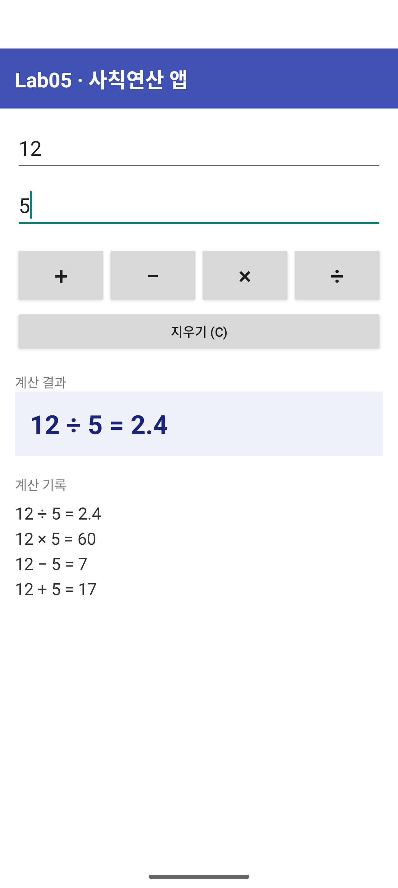
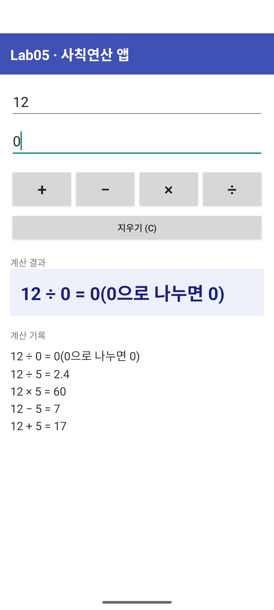

# lab05 (실습과제05)

| 폴더 | 실습 |
|---|---|
| [`01_tdd_four_basic_opt/`](01_tdd_four_basic_opt) | 실습 1 - Test-Driven Development: 사칙연산 (ch04 p.48~52) |
| [`02_android_calculator_app/`](02_android_calculator_app) | 실습 2 - 사칙연산을 수행하는 안드로이드 앱 |

## 실습 1 결과 (최종 콘솔)

## 실습 2 결과 (에뮬레이터 화면)

| 사칙연산 (12, 5) | 0으로 나누기 (12 ÷ 0) |
|---|---|
|  |  |
